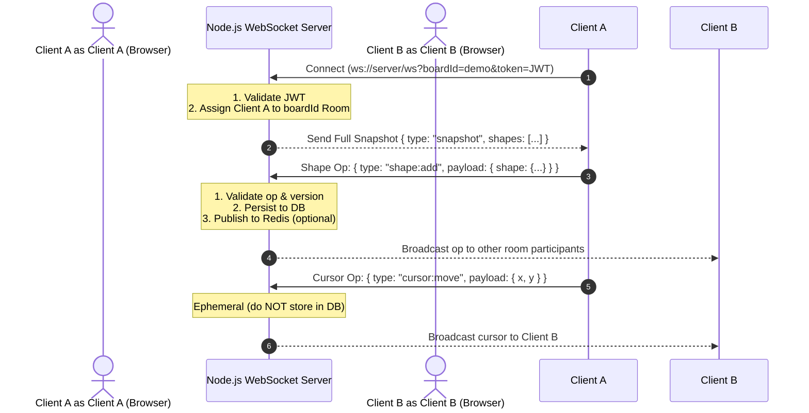

# Whiteboard Backend & Collaboration Protocol Specification

This document provides the complete backend architecture, connection lifecycle, and serializable JSON message contracts required to integrate a collaborative Node.js WebSocket backend with the Whiteboard frontend.

---

## 1. Protocol Architecture & Connection Flow

Communication between the frontend client and the backend server uses standard **WebSockets (`ws://` or `wss://`)**.



---

## 2. Connection Handshake & Authentication

### Endpoint
```
ws://<server-host>:<port>/ws?boardId=<boardId>&token=<jwtToken>
```

### Handshake Lifecycle
1. **Query Parameters**:
   - `boardId`: Unique identifier for the whiteboard room.
   - `token`: Bearer JWT token verifying user identity.
2. **Authentication Verification**:
   - On the HTTP upgrade / connection event, parse query parameters and verify the JWT.
   - If invalid or expired, reject the connection or close the socket with code `4001` (`Unauthorized`).
3. **Room Association**:
   - Add the verified WebSocket connection to the set of clients for `boardId`.
4. **Initial Snapshot Delivery**:
   - Immediately send the full room snapshot to the newly connected client.

---

## 3. Data Formats & Message Schemas

All messages over the WebSocket are UTF-8 encoded JSON strings (`JSON.parse` / `JSON.stringify`).

### Base Operation Envelope
Every message sent between client and server follows this standard schema:

```typescript
interface BaseOperation<TType extends string, TPayload> {
  id: string;          // UUID v4 uniquely identifying the operation
  type: TType;         // Operation discriminator
  payload: TPayload;   // Type-specific data
  version: number;     // Monotonic version counter
  userId: string;      // 8-character client ID (e.g. "a1b2c3d4")
  timestamp: number;   // Epoch timestamp in milliseconds
}
```

---

### A. Initial Snapshot (`snapshot`)
Sent by the backend to a newly joined client upon successful connection.

```json
{
  "type": "snapshot",
  "version": 42,
  "shapes": [
    {
      "id": "7b822d10-84cf-4770-9856-74a408b049ff",
      "type": "rectangle",
      "x": 200,
      "y": 150,
      "width": 180,
      "height": 120,
      "style": {
        "strokeColor": "#6366f1",
        "fillColor": "transparent",
        "strokeWidth": 2,
        "opacity": 1
      },
      "data": {}
    }
  ]
}
```

---

### B. Add Shape (`shape:add`)
Broadcast when a user draws or places a shape.

```json
{
  "id": "e0d02b54-945f-45a7-96a8-fbe0d79744c8",
  "type": "shape:add",
  "payload": {
    "shape": {
      "id": "583c27e8-3486-444a-9cb0-1845bb08a184",
      "type": "star",
      "x": 340,
      "y": 210,
      "width": 100,
      "height": 100,
      "style": {
        "strokeColor": "#f59e0b",
        "fillColor": "transparent",
        "strokeWidth": 2,
        "opacity": 1
      },
      "data": {}
    }
  },
  "version": 1,
  "userId": "a1b2c3d4",
  "timestamp": 1729158400000
}
```

> **Note on Freehand Shapes**: When `shape.type === "freehand"`, `shape.data` contains point coordinates:
> ```json
> "data": {
>   "points": [
>     { "x": 100, "y": 100 },
>     { "x": 105, "y": 103 },
>     { "x": 112, "y": 109 }
>   ]
> }
> ```

---

### C. Update Shape (`shape:update`)
Broadcast when a shape is translated, resized, or restyled.

```json
{
  "id": "9218fb41-471f-4cb1-97b7-ea26c3682974",
  "type": "shape:update",
  "payload": {
    "id": "583c27e8-3486-444a-9cb0-1845bb08a184",
    "changes": {
      "x": 420,
      "y": 260,
      "width": 140,
      "height": 140
    },
    "previous": {
      "x": 340,
      "y": 210,
      "width": 100,
      "height": 100
    }
  },
  "version": 2,
  "userId": "a1b2c3d4",
  "timestamp": 1729158401200
}
```

---

### D. Remove Shape (`shape:remove`)
Broadcast when one or more shapes are deleted.

```json
{
  "id": "4ac91839-a9a3-4a11-8fc3-b778749a2155",
  "type": "shape:remove",
  "payload": {
    "id": "583c27e8-3486-444a-9cb0-1845bb08a184",
    "shape": {
      "id": "583c27e8-3486-444a-9cb0-1845bb08a184",
      "type": "star",
      "x": 420,
      "y": 260,
      "width": 140,
      "height": 140,
      "style": {
        "strokeColor": "#f59e0b",
        "fillColor": "transparent",
        "strokeWidth": 2,
        "opacity": 1
      },
      "data": {}
    }
  },
  "version": 3,
  "userId": "a1b2c3d4",
  "timestamp": 1729158403500
}
```

---

### E. Remote Cursor Move (`cursor:move`)
Broadcast throttled cursor positions for collaborative pointer rendering.

```json
{
  "id": "f128c942-8321-419b-a010-863a8a3857e4",
  "type": "cursor:move",
  "payload": {
    "x": 582.4,
    "y": 312.8,
    "userName": "User a1b2",
    "color": "#6366f1"
  },
  "version": 3,
  "userId": "a1b2c3d4",
  "timestamp": 1729158404100
}
```

---

## 4. Persistence & Storage Rules

| Operation Type | Persist to Database? | Broadcast to Room Peers? | Notes |
| :--- | :---: | :---: | :--- |
| `shape:add` | **YES** | **YES** | Insert shape into DB / snapshot |
| `shape:update` | **YES** | **YES** | Patch shape in DB / snapshot |
| `shape:remove` | **YES** | **YES** | Delete shape from DB / snapshot |
| `cursor:move` | **NO** | **YES** | Ephemeral stream, never write to disk |

---

## 5. Scaling Across Multiple Instances (Redis Pub/Sub)

For horizontal scaling across multiple Node.js worker processes or server containers:
- Use Redis Pub/Sub channels keyed by board ID (`board:<boardId>:events`).
- When an instance receives a valid shape or cursor operation:
  1. Publish the JSON operation to Redis: `redis.publish(`board:${boardId}:events`, JSON.stringify(op))`
  2. Each subscriber instance forwards the message to all local WebSockets attached to that `boardId` (excluding the origin `userId`).

---

## 6. Complete Node.js + TypeScript Server Blueprint

```typescript
import http from 'http';
import url from 'url';
import { WebSocketServer, WebSocket } from 'ws';

interface Shape {
  id: string;
  type: string;
  x: number;
  y: number;
  width: number;
  height: number;
  style: Record<string, unknown>;
  data?: Record<string, unknown>;
}

const server = http.createServer();
const wss = new WebSocketServer({ server });

// Map<boardId, Set<WebSocket>>
const rooms = new Map<string, Set<WebSocket>>();
// Map<boardId, Map<shapeId, Shape>>
const boardSnapshots = new Map<string, Map<string, Shape>>();

wss.on('connection', (ws: WebSocket, req: http.IncomingMessage) => {
  const parsedUrl = url.parse(req.url || '', true);
  const boardId = (parsedUrl.query.boardId as string) || 'default-board';

  // 1. Join room
  if (!rooms.has(boardId)) rooms.set(boardId, new Set());
  if (!boardSnapshots.has(boardId)) boardSnapshots.set(boardId, new Map());

  const room = rooms.get(boardId)!;
  const snapshot = boardSnapshots.get(boardId)!;
  room.add(ws);

  // 2. Send initial snapshot to joining client
  ws.send(
    JSON.stringify({
      type: 'snapshot',
      version: snapshot.size,
      shapes: Array.from(snapshot.values()),
    })
  );

  // 3. Handle incoming operations
  ws.on('message', (data: Buffer | string) => {
    try {
      const op = JSON.parse(data.toString());

      // Persist durable shape operations
      if (op.type === 'shape:add') {
        snapshot.set(op.payload.shape.id, op.payload.shape);
      } else if (op.type === 'shape:update') {
        const existing = snapshot.get(op.payload.id);
        if (existing) {
          snapshot.set(op.payload.id, {
            ...existing,
            ...op.payload.changes,
          });
        }
      } else if (op.type === 'shape:remove') {
        snapshot.delete(op.payload.id);
      }

      // Broadcast to all other peers in the room
      const raw = JSON.stringify(op);
      for (const client of room) {
        if (client !== ws && client.readyState === WebSocket.OPEN) {
          client.send(raw);
        }
      }
    } catch (err) {
      console.error('Failed to process operation message', err);
    }
  });

  // 4. Handle disconnection
  ws.on('close', () => {
    room.delete(ws);
    if (room.size === 0) {
      rooms.delete(boardId);
    }
  });
});

const PORT = process.env.PORT || 8080;
server.listen(PORT, () => {
  console.log(`Whiteboard collaboration server listening on port ${PORT}`);
});
```

---

## 7. Connecting Frontend to Backend

In `src/App.tsx`, simply pass your server URL:

```tsx
import { WhiteboardCanvas } from './components/WhiteboardCanvas.tsx';
import './App.css';

export default function App() {
  return (
    <main className="whiteboard-app">
      <WhiteboardCanvas serverUrl="ws://localhost:8080/ws?boardId=my-room" />
    </main>
  );
}
```
